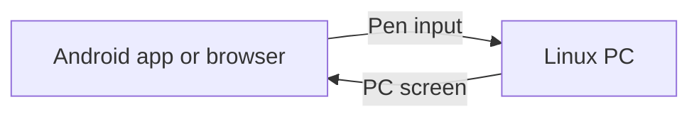

# StylLink

Use your Android tablet as a pen tablet for Linux. Draw on the tablet while you
see the PC screen under the pen.

- Use pen pressure, tilt, the pen button, and the eraser.
- Connect through USB or Wi-Fi.
- Use the Android app or the [website](https://styllink.vercel.app/).




## What you need

- A Linux PC with Make and access to `/dev/uinput`.
- An X11 desktop session for screen sharing. Tested with Ubuntu 22.04 and X11.
- An Android tablet with a pen. The native app requires Android 11 or later.
- For the website, use Chrome for the hosted connection. Firefox may block it.
- For USB, install ADB on the PC and use a USB cable that transfers data.

## Start the server

Download the [Linux package](https://github.com/davidnoronha1/styllink/actions/runs/38715104674/artifacts/11963055735)
and, if required, the [Android APK](https://github.com/davidnoronha1/styllink/actions/runs/38715104674/artifacts/11962136870).
Build downloads expire after 30 days. Use [All builds](https://github.com/davidnoronha1/styllink/actions/workflows/build.yml)
if a download has expired.

1. Extract the Linux ZIP file. Then extract the `.tar.gz` file inside it.
2. Open a terminal in the extracted folder.
3. Configure pen input once. This command requires `sudo`:

   ```sh
   make install-uinput-access
   ```

4. Start the server:

   ```sh
   make run
   ```

Keep the server running while you draw. Use a trusted network. The connection
to the PC is not encrypted.

## Connect the tablet

### Use Wi-Fi

1. Connect the PC and tablet to the same network.
2. Select one client:
   - **Android app:** Install `styllink.apk`. Open the app menu. Select
     **Open camera to scan QR**. Scan the Wi-Fi QR code in the PC terminal.
   - **Website:** Open the complete **Browser (Chrome)** link from the PC terminal
     on the tablet. Allow local-network access if the browser requests it.
3. Wait for the connected status. Keep the app or page visible and the tablet unlocked.
4. Draw on the image of the PC screen.

### Use USB

1. Enable USB debugging on the tablet.
2. Connect the USB cable. Approve the PC on the tablet.
3. Run `make run` on the PC. Wait for the **USB ready** message.
4. In the Android app, scan the USB QR code. For the website, open the USB browser
   link from the terminal, such as `http://localhost:8080/?t=YOUR_TOKEN`.

In the Android app, you can also select **Use USB · localhost:8080**, then **Connect**.
Use the port and token shown in your terminal.

### Change settings

- **Website:** Tap the top-right corner to open the menu.
- **Android app:** Open the app menu.
- Enter the PC address and token manually if you cannot use the link or QR code.
- Use **Show PC screen** to control screen sharing in the website.
- Use the finger input and ink trail settings as required.
- Select **Prefer H.264** for video or a weak Wi-Fi connection.

## If the connection fails

- Check that the PC server is running.
- Check the PC address, port, and token against the terminal output.
- For Wi-Fi, check that both devices use the same network. Check that the PC
  firewall permits the server port. The default port is `8080`.
- For USB, check that ADB detects an approved tablet. Start `make run` again.
- If Firefox cannot connect to the hosted page, try Chrome or the terminal's
  **Local browser fallback** link. The local HTTP page can reduce pen sampling.
- If pen input works but the PC screen is missing, check that the PC uses X11.

The website shows a notice when a connection fails or takes more than eight
seconds. Select **Connection settings** to check the address and token.
The notice clears when the connection succeeds.

## Common commands

| Task | Command |
| --- | --- |
| Select a monitor | `MONITOR=HDMI-0 make run` |
| Change the port | `make run ARGS="--port 9000"` |
| Use pen input without screen sharing | `make run ARGS="--no-video"` |
| Reduce screen bandwidth | `make run ARGS="--preset fast"` |
| Record a diagnostic log | `make run DEBUG=1` |
| Show build and run commands | `make help` |
| Show server options | `./styllink --help` |

To build from source, use the Zig version in [.zig-version](.zig-version), then
run `make build`. See [WORKING.md](WORKING.md) for the Android build, screen
presets, protocols, and technical details. For an extended desktop, use the
[second monitor instructions](assets/second-monitor.md).
