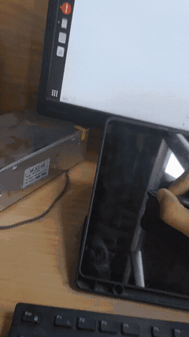

# StylLink

Use your Android tablet as a pen tablet for Linux, with the Android app or a browser.

Supports pressure, tilt, the pen button, and the eraser. Shows the PC screen
under the pen, so you draw on the picture itself.
Works through Wi-Fi or USB. Built with Zig, native Android views, and a browser client.

**Website:** [styllink.vercel.app](https://styllink.vercel.app/) — use StylLink in
Chrome without installing the Android APK. The Linux server still runs on your PC.



[How it works](WORKING.md)

## Install

Download: [Linux](https://github.com/davidnoronha1/styllink/actions/runs/38715104674/artifacts/11963055735) · [Android APK](https://github.com/davidnoronha1/styllink/actions/runs/38715104674/artifacts/11962136870) · [All builds](https://github.com/davidnoronha1/styllink/actions/workflows/build.yml)

Artifacts expire after 30 days. Open **All builds** for newer downloads.

1. Extract the Linux ZIP, then extract its `.tar.gz` file.
2. Run these commands on your PC:

```sh
make install-uinput-access   # Run once. Requires sudo.
make run
```

For the native Android client, extract the Android ZIP and install `styllink.apk`
on your tablet. Browser users can skip the APK.

The PC requires Make, Linux with uinput and libinput, and X11 for screen sharing.
The native app requires Android 11 or later; the website uses Chrome with pen support.
Tested with Ubuntu 22.04 and X11.

## Connect with the Android app

Open the app menu. Select **Open camera to scan QR**.
Scan a QR code from the PC terminal, then open its link.

- **USB:** Enable USB debugging and approve the PC. The server sets up
  forwarding and shows the USB QR first. Requires ADB on the PC.
- **Wi-Fi:** Connect both devices to the same network. Scan the Wi-Fi QR.

You can also enter the address and token from the terminal.
To switch to USB, select **Use USB · localhost:8080**, then **Connect**.
Keep the app open and the tablet unlocked.

The tablet shows the mapped monitor and the pen lands where you see it.
The desktop mouse cursor appears in the stream too.
The menu can turn the screen off, switch off front-buffer rendering
if you see tearing, or prefer H.264 for video or weak Wi-Fi.
Screen sharing requires an X11 session. Video settings adapt automatically.

The menu also has finger input and trail settings.
Set **Trail fade** from 0.1 to 5 seconds.

## Use the website

[styllink.vercel.app](https://styllink.vercel.app/) is the browser client. It
connects directly to the StylLink server on your PC for pen input and screen
sharing. Keep the server running while you draw.

### Wi-Fi

1. Connect the PC and tablet to the same network, then start `make run` on the PC.
2. On the tablet, open the complete **Browser (Chrome)** URL printed in the terminal.
   It opens the website with the PC address and access token already filled in.
3. Allow local-network access if Chrome asks, then wait for the connected status.
   See [Chrome's local-network permission guide](https://developer.chrome.com/docs/modern-web-guidance/guides/security/local-network-access)
   if access was previously blocked.
4. Draw with the pen on the displayed PC screen. Keep the page visible and the
   tablet unlocked.

The terminal QR codes open the native Android app. Use the **Browser (Chrome)**
link for the website.

To connect manually, open the website and tap the top-right corner to reveal its
menu. Enter the server's address in **PC address**, such as `192.168.1.20:8080`,
and copy its token from the terminal's browser URL into **Token**. Press **Connect**.
The address must point to your PC; opening the website alone does not start a server.

For example, a complete browser link looks like:

```text
https://styllink.vercel.app/#h=192.168.1.20:8080&t=YOUR_TOKEN
```

In the menu, **Show PC screen** controls screen sharing, **Finger drawing**
enables touch input, and **Ink trail preview** shows a local pen trail.
Use **Fullscreen** to hide browser controls. **Prefer H.264 screen** requests
H.264 when the server uses the `auto` preset and the browser supports decoding it.

### USB and the local page

Enable USB debugging, approve the PC, and run `make run` with ADB installed.
The launcher sets up USB forwarding automatically. On the tablet, open the
terminal's **USB** browser address in Chrome, for example:

```text
http://localhost:8080/?t=YOUR_TOKEN
```

This serves the same browser client directly from the PC through USB forwarding.
Replace the token and port with the values printed by your server.

The terminal also prints a **Local browser fallback** URL using the PC's LAN
address. That HTTP page can have a lower pen sampling rate because full-rate pen
APIs require a secure context. Prefer the hosted HTTPS page for Wi-Fi, or the
`localhost` page for USB. If the hosted page cannot connect, check the PC address,
server port, and Chrome's local-network permission.


## Build

Use the Zig version in [.zig-version](.zig-version):

```sh
make build                  # Static Linux binary: zig-out/bin/styllink.
make test                   # Unit tests.
make run                    # Builds and starts the server.
```

For Android, install JDK 21 or later and set `ANDROID_HOME` to your SDK path:

```sh
sdkmanager 'platforms;android-36' 'build-tools;36.0.0' 'platform-tools'
sdkmanager --licenses
make apk               # Creates zig-out/android/styllink.apk.
make apk-install       # Builds and installs through ADB.
```

[GitHub Actions](https://github.com/davidnoronha1/styllink/actions/workflows/build.yml) builds both packages on each push.
Set `ANDROID_DEBUG_KEYSTORE_BASE64` to keep the CI signing key stable.
A different key requires you to uninstall the old app before you install the new APK.

## Options

```sh
make run ARGS="--port 9000"  # Use another port.
MONITOR=HDMI-0 make run              # Select a monitor.
MONITOR=STYLLINK make run            # Select an existing RandR logical monitor.
STYLLINK_USB=0 make run              # Skip automatic USB setup.
make run ARGS="--no-uinput"  # Test the link without desktop input.
make run ARGS="--no-video"  # Pen only, no screen.
make run ARGS="--preset fast"  # Reduce video bandwidth and queue depth.
```

Video presets are selected after the tablet reports its capabilities:

| Preset | Preference |
| --- | --- |
| `auto` (default) | Adapt to the connection and tablet; honor its H.264 preference. |
| `quality` | Full-resolution tiles with true color where supported. |
| `fast` | Half-resolution tiles, RGB565 where supported, one frame in flight. |
| `h264` | H.264 through ffmpeg; fall back to tiles if unsupported. |

All presets use the tablet's refresh rate and supported formats. Tablet settings
remain available; an explicit preset takes priority over the H.264 preference.

Pass server options with `ARGS`, for example `make run ARGS="--port 9000"`.
Use `make deploy-web` to deploy the browser page to Vercel.
Run `make help` for available targets.

Run `./styllink --help` for every option. See [the remote screen](WORKING.md#remote-screen-pc--tablet)
for the streaming protocol.

For an extended desktop on the tablet, see [second monitor setup](assets/second-monitor.md).

USB gives the most stable connection. For wireless use, try Ethernet on the PC.
JSON logging is off by default. Run `make run DEBUG=1` to record events in
`styllink.log` if input stops or has delays. To choose another path, use
`make run DEBUG=1 ARGS="--log /tmp/styllink.log"`.

Use a trusted network. The connection is not encrypted.
