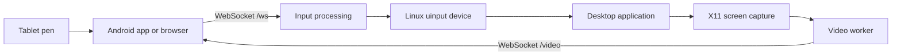
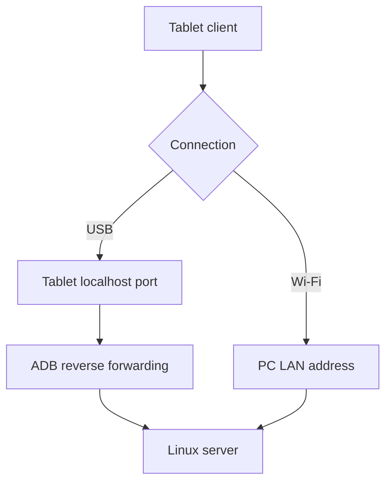
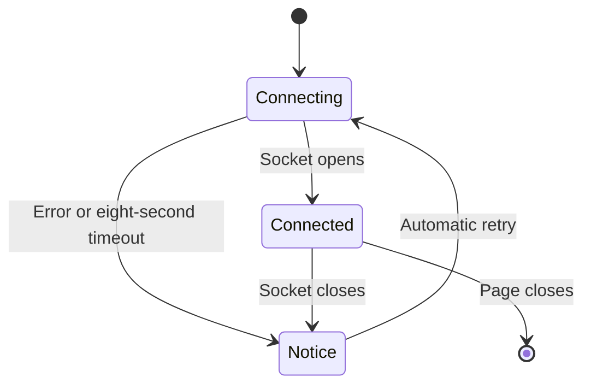
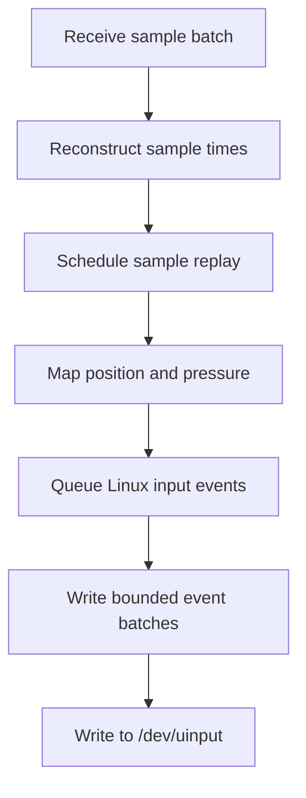
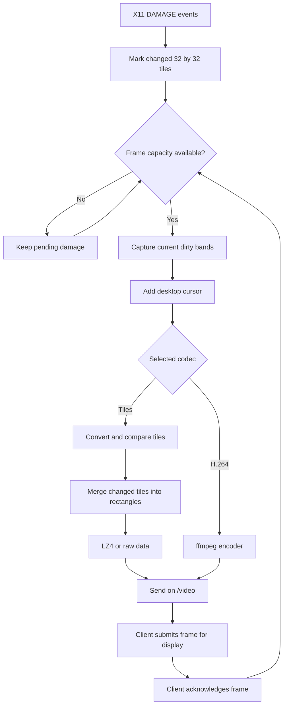
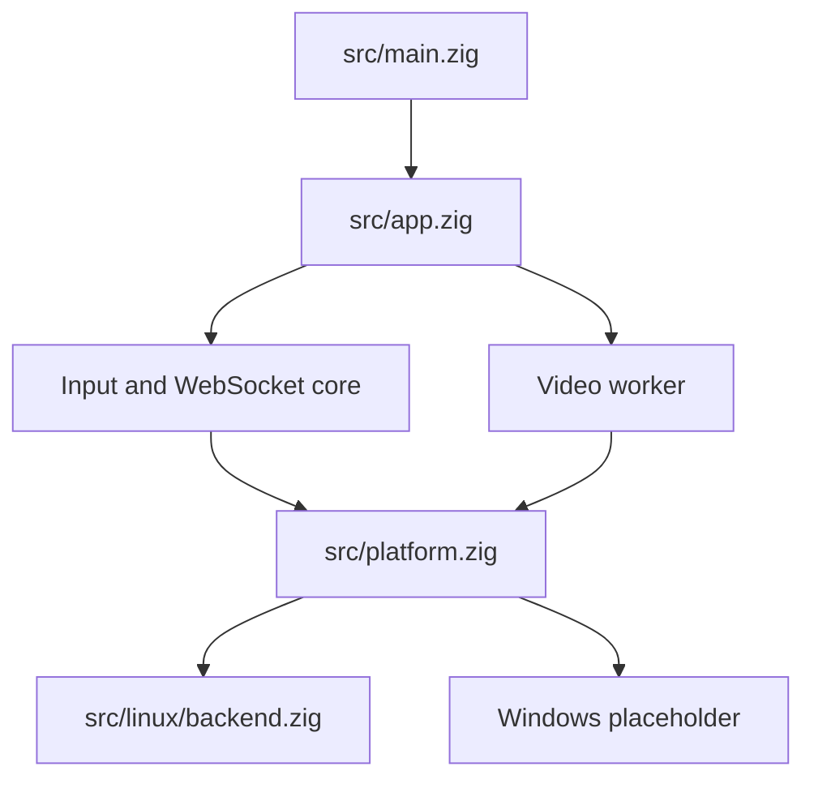

# How StylLink works

This file describes the implementation and developer commands.
For installation and connection instructions, see [README.md](README.md).

## System overview

The tablet sends pen samples to the Linux server. The server converts the samples
into input events for a virtual tablet named **StylLink Pen**. A separate video
worker sends the selected PC screen region to the tablet.



Input and video use separate sockets on the same port. A large video frame does
not enter the pen socket queue. The default port is `8080`. Both sockets can use
one ADB reverse connection.

The server runs on Linux. Screen sharing requires X11. The Windows backend is a
placeholder and does not provide Windows support.

## Connections and access

### USB and Wi-Fi



- **USB:** `make run` detects a single approved physical ADB device. It runs
  `adb reverse tcp:PORT tcp:PORT` and prints the USB QR code first.
- **Wi-Fi:** The tablet connects to the PC's LAN address. The server uses route
  discovery to select a local address for the terminal links.
- **Disable automatic USB setup:** Run `STYLLINK_USB=0 make run`.

### Tokens and links

`make run` creates a random token in `.styllink-token` and reuses it on later
starts. The file has private permissions. If you start the binary directly,
it generates a new token unless you supply `--token`.

The server checks the `t` query parameter. A wrong token produces HTTP `403`.
The token controls access; it does not encrypt the connection.

| Client | Link format |
| --- | --- |
| Android app | `styllink://connect?h=HOST:PORT&t=TOKEN` |
| Hosted website | `https://styllink.vercel.app/#h=HOST:PORT&t=TOKEN` |
| Local website | `http://HOST:PORT/?t=TOKEN` |
| Website over USB | `http://localhost:PORT/?t=TOKEN` |

The hosted link keeps the address and token in the URL fragment. The browser
does not send that fragment to the website host. The client then connects
directly to the PC through `ws://`.

### Browser behavior

The website checks pen API support at run time:

1. Use `pointerrawupdate` if available.
2. Otherwise, use `pointermove`.
3. Read `getCoalescedEvents()` if available to obtain samples between events.

Some pen APIs require a secure context, such as HTTPS or localhost. A local
HTTP page on a LAN address can provide fewer samples. API availability also
depends on the browser and device.

The hosted page uses HTTPS, but the PC sockets use `ws://`. Browser security
rules can block this connection. Chrome can request local-network permission.
Firefox may reject the connection. Use the terminal's local HTTP page or USB
localhost page if the hosted connection fails.



The notice includes connection settings and troubleshooting steps. It adds
Firefox guidance for failed connections from HTTPS pages. A WebSocket error
does not identify its exact cause, so the notice describes a possible restriction.
The notice clears when the connection opens. Retries increase from 300 ms to a
maximum of three seconds. Initial connection starts after page state is initialized.

## Pen input

### Sample format

The client sends binary WebSocket messages. Each message contains a four-byte
send timestamp, followed by ten-byte samples. All multi-byte integers use
little-endian order.

| Offset | Type | Field | Meaning |
| --- | --- | --- | --- |
| Header 0 | `u32` | Send time | Client monotonic time, in 0.1 ms units |
| Sample 0 | `u16` | X | Position from 0 to 65535 |
| Sample 2 | `u16` | Y | Position from 0 to 65535 |
| Sample 4 | `u16` | Pressure | Pressure from 0 to 65535 |
| Sample 6 | `i8` | Tilt X | Angle in degrees |
| Sample 7 | `i8` | Tilt Y | Angle in degrees |
| Sample 8 | `u8` | Flags | Pen state bits |
| Sample 9 | `u8` | Age | Sample age at send time, in 0.5 ms units |

| Flag bit | Meaning |
| --- | --- |
| 0 | Pen is in range |
| 1 | Tip touches the surface |
| 2 | Pen side button is pressed |
| 3 | Eraser is active |

Sample age separates time spent waiting in the client from network delay.
Client timestamps help measure delay variation without synchronized device clocks.

### Timing and Linux events



- Replay retains relative sample timing. Late samples use a default catch-up
  speed of twice the original speed. The default fixed replay delay is zero.
- Event writes end at `SYN_REPORT` boundaries. Each write contains at most 48
  events. Queued batches have a 1 ms interval to let the desktop read them.
- Steady input can flush immediately. Pacing protects the evdev queue when
  network delays cause a burst of samples.
- Pen processing uses fixed buffers. It does not allocate memory for each sample.

The virtual device reports absolute position, pressure, tilt, pen proximity,
eraser state, tip contact, and the pen button. Position ranges from 0 to 65535.
Linux pressure ranges from 0 to 4095. Tilt ranges from -90 to 90 degrees.

The input code handles three libinput behaviors:

- It enters proximity with zero pressure so libinput gets a correct baseline.
- It maps contact pressure to at least 6% of the Linux pressure range so light
  contact can cross the libinput contact threshold.
- The default smoothing workaround emits four frames per sample. It alternates
  position by one device unit. Pressure and buttons change on the final frame.

`make install-uinput-access` also installs a libinput smoothing override.
The frame-repeat count is an internal input setting.

### Screen mapping and local preview

`make run` uses `xrandr` to obtain the desktop size and selected monitor region.
Set `MONITOR` to select a physical output or an existing RandR logical monitor.
The launcher rejects a selected region outside the desktop framebuffer.

For each axis, the server maps the local coordinate with this relation:

```text
global = (offset * 65535 + local * region_span) / desktop_span
```

The binary also accepts `--region X,Y,W,H` and `--desktop W,H` for launcher use.
See [second monitor setup](assets/second-monitor.md) for a virtual display region.

The tablet keeps the screen image in the PC's aspect ratio. Pen coordinates are
relative to that image. Local ink trails provide immediate visual feedback.
Android can use `MotionPredictor` on API 34 or later. The website uses
`getPredictedEvents()` when available. Predicted points extend the local preview;
actual samples provide the PC input.

## Remote screen (PC → tablet)

### Capture and delivery



The video worker uses its own event loop at normal priority. The input loop can
use higher priority when the internal runtime configuration enables it.

- X11 DAMAGE events identify areas that may have changed.
- A 250 ms rescan checks for changes that DAMAGE missed.
- Capture uses pipelined MIT-SHM requests when available. It falls back to X11
  `GetImage` when shared memory is unavailable.
- XFixes supplies the desktop cursor. Pointer queries run at 8 ms intervals.
- Converted tiles are compared with the previous frame. Unchanged tiles are skipped.
- Changed tiles merge into rectangles, up to four tile rows high. A rectangle
  uses LZ4 only when compression reduces its size.

The default limit is two frames awaiting acknowledgement. When the limit is
reached, capture waits. The next capture uses the current screen. This prevents
old frames from building up on a slow connection.

An acknowledgement means the client submitted a frame for presentation.
It does not measure the time when the physical display showed the pixels.

### Format negotiation and presets

The client sends its screen size, refresh rate, pixel formats, compression
methods, codecs, and connection type. For example:

```text
hv=1;w=2560;h=1600;hz=120;pix=bgrx,rgb565;enc=lz4,raw;codec=tiles,h264;link=usb
```

It can add `;prefer=h264`. The server replies with the selected format:

```text
ccodec=tiles;w=1920;h=1080;pix=bgrx;enc=lz4;scale=1;fps=120;inflight=2;tile=32
```

The server can change the format during a session. A key frame follows the change.

| Preset | Preferred behavior |
| --- | --- |
| `auto` | Adapt to client capabilities and connection. Honor the client's H.264 preference. |
| `quality` | Use full-resolution tiles and BGRX when supported. |
| `fast` | Use half-resolution tiles, RGB565 when supported, and one frame awaiting acknowledgement. |
| `h264` | Use H.264 when supported. Otherwise, use tiles. |

Explicit presets take priority over the client's H.264 preference. The browser
advertises H.264 only when `VideoDecoder` reports a supported configuration.

Automatic selection favors BGRX on USB and RGB565 on Wi-Fi. RGB565 uses half as
many bytes per pixel. Slow BGRX acknowledgements can trigger a switch to RGB565.
Resolution and capture rate depend on the client size and refresh rate.
Capture can run at up to twice the client refresh rate.

### Video messages

Multi-byte fields use little-endian order.

| Message | Header before payload |
| --- | --- |
| `T`: tile rectangle | Type byte, flags, encoding, pixel format, `u32` frame ID, `u32` capture time, `u16` X, Y, width, height, `u32` raw size |
| `H`: H.264 access unit | Type byte, flags, two reserved bytes, `u32` frame ID, `u32` capture time, `u32` encode time |

- Tile flags: bit 0 marks the final rectangle of a frame; bit 1 marks a key frame.
- Tile encoding: 0 is raw; 1 is LZ4. Pixel format: 0 is BGRX; 1 is RGB565.
- H.264 flags: bit 1 marks a key frame; bit 2 marks a duplicate frame.
- Capture time uses 0.1 ms units. H.264 encode time uses microseconds.
- The client sends `a<ID>` to acknowledge a frame.

The built-in H.264 path requires ffmpeg with x264. It feeds captured BGRX frames
to the encoder. Duplicate frames release real frames held in the encoder pipeline.
The client decodes duplicates without acknowledging them. A key-frame request
restarts the encoder. Custom encoder and capture commands are internal settings,
not command-line options.

### Client rendering

| Client path | Implementation |
| --- | --- |
| Android tiles | Decode LZ4, upload changed texture regions, and draw with OpenGL. Use front-buffer rendering when available; otherwise, use swaps without a swap interval. |
| Android H.264 | Decode to the display surface with MediaCodec. Prefer a decoder with low-latency support. |
| Browser tiles | Write rectangles with `putImageData` on a canvas. |
| Browser H.264 | Decode with WebCodecs and request `optimizeForLatency`. |

Android requests the fastest display refresh mode. The app can disable
front-buffer rendering if the device shows tearing.

## Network and diagnostics

### Delay controls

The server requests these socket settings where supported:

- `TCP_NODELAY` to send small messages without Nagle buffering.
- `TCP_QUICKACK` after reads to reduce delayed acknowledgements.
- DSCP EF for pen traffic and AF41 for video traffic.
- Bounded socket buffers to limit queued data.

Network equipment decides whether to honor traffic priority. These settings do
not guarantee a latency value. Android requests a low-latency Wi-Fi lock. The
website sends a small keepalive every 50 ms when **Keep Wi-Fi awake** is enabled.

### Measurements and logs

The server measures round-trip time, uplink delay variation, and Linux TCP
statistics. Client sample age helps distinguish client delays from network delays.

```sh
make run DEBUG=1
make run DEBUG=1 ARGS="--log /tmp/styllink.log"
```

JSON logging is off by default. When enabled, it records connection, capability,
benchmark, stall, statistics, and disconnect events. Video adds format and
per-second frame statistics.

| Tile timing field | Includes |
| --- | --- |
| `capture_avg_ms` | Damage processing, capture submission, X11 reply wait, and cursor composition |
| `diff_avg_ms` | Pixel conversion and tile comparison |
| `encode_avg_ms` | Rectangle construction, compression, and socket enqueue attempts |

These fields describe emitted frames. Enqueue time is not transmission time.
Capture-to-acknowledgement time also excludes the final physical display delay.

To enable Android video diagnostics:

1. Run `adb shell setprop log.tag.StylLinkVideo DEBUG`.
2. Reconnect the app.
3. Run `adb logcat -s StylLinkVideo`.

The log reports the renderer and aggregate decode, upload, and presentation-call
CPU time. Set the tag to `INFO` and reconnect to disable these diagnostics.

## Source organization



| Files under `src/` | Responsibility |
| --- | --- |
| `app.zig`, `banner.zig`, `config.zig` | Startup, shutdown, terminal links, and options |
| `input.zig`, `input/events.zig` | Pen state, mapping, sample timing, and portable events |
| `ws.zig` | HTTP, WebSocket, and client messages |
| `stats.zig` | Metrics and JSON logs |
| `util.zig`, `memory.zig` | Clocks, randomness, and allocation cleanup |
| `video/formats.zig` | Client capabilities and preset selection |
| `video/pixels.zig`, `video/tiles.zig` | Pixel conversion and changed rectangles |
| `video/runtime.zig`, `video/session.zig` | Worker and session state |
| `video/capture.zig`, `video/encoder.zig`, `video/transport.zig` | Capture, ffmpeg, and frame delivery |
| `linux/` | uinput, X11, sockets, scheduling, and event-loop services |

The platform interface provides `Reactor`, `Timer`, `Channel`, `IO`, `Capture`,
`InputDevice`, `Network`, and `Scheduling` services. Common code owns protocol
and preset decisions. Linux-specific operations stay in the backend.

`App` receives the caller's allocator and `std.Io` context. The video worker is
joined before the allocator and logger are released. Video buffers use that
allocator. MIT-SHM memory is an X11 resource owned by capture. Allocation-failure
tests check partial cleanup.

The Linux backend uses epoll and timerfd behind the platform interface.
Nonblocking socket and pipe adapters use `std.Io.File`. Listener setup retains
exclusive port ownership. Internal runtime settings can enable busy polling or
request real-time scheduling; the public CLI does not expose these settings.

## Build and publish

### Linux

Use the Zig version in [.zig-version](.zig-version).

```sh
make build
make test
make run
```

`make build` creates `zig-out/bin/styllink` and updates the root `styllink`
executable. An extracted Linux package uses its supplied executable.

### Android

Install JDK 21 or later. Set `ANDROID_HOME` to the Android SDK directory.

```sh
sdkmanager 'platforms;android-36' 'build-tools;36.0.0' 'platform-tools'
sdkmanager --licenses
make apk
make apk-install
```

The APK is written to `zig-out/android/styllink.apk`. Zig runs the Android SDK
tools for resources, Java compilation, DEX conversion, packaging, and signing.

[GitHub Actions](https://github.com/davidnoronha1/styllink/actions/workflows/build.yml)
builds the Linux and Android packages. Set `ANDROID_DEBUG_KEYSTORE_BASE64` to
keep the CI signing key stable. If the signing key changes, uninstall the old
Android app before installing the new APK.

### Website

```sh
make deploy-web
```

This command copies only `web/index.html` into `.deploy/styllink` and publishes
it to the configured Vercel production project. It requires Node.js, network
access, and Vercel credentials. The Linux server also serves a copy of the page.
Use `make help` for available targets and `./styllink --help` for server options.
